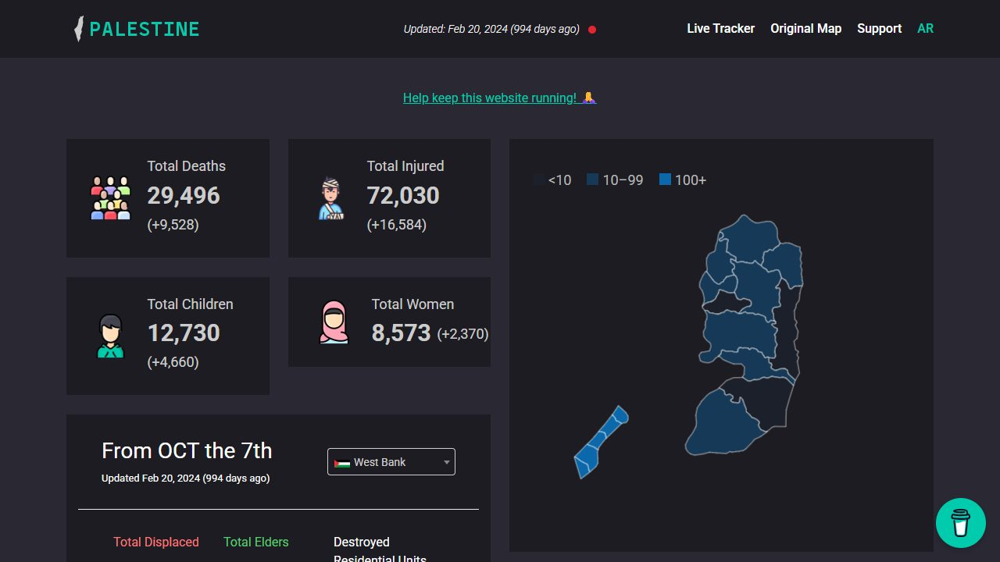

# Palestine Crisis

A live tracker of the war on Palestine since 7 October 2023, in English and Arabic, that installs as an app and keeps working offline.

**Site:** https://samehbilal.github.io/palestine-crises/



## Pages

| Page | What it shows |
|---|---|
| [`live.html`](live.html) | Home. Deaths, injuries, children, women, the displaced and destroyed homes, the medical sector, a map of every region, and a chart of the toll since day 1 |
| [`map.html`](map.html) | Deaths by region on the map, and a timeline of key events from the 1948 Nakba onwards |
| [`brands.html`](brands.html) | Brands that support the occupation; each card turns over to show an alternative |
| [`celebrities.html`](celebrities.html) | Where celebrities stand |
| [`barcodes.html`](barcodes.html) | Barcode prefixes that show which country a product comes from |
| [`landing.html`](landing.html), [`landing-ar.html`](landing-ar.html) | Animated intro pages |

Every page switches between English and Arabic with the **AR / EN** link; `?lang=ar` or `?lang=en` in a link opens it in that language.

## Updating the figures

All figures are in [`data/`](data/). The pages only read these files, so an update is a data change and a commit.

| File | Holds |
|---|---|
| `livetracker.json` | The overall totals and when they were updated (`last_update`) |
| `history.json` | The total death toll at each update, which draws the chart. Add a point whenever `livetracker.json` changes |
| `attacks.json` | Figures per region. `is_aggregate` marks West Bank and Gaza totals |
| `regions.json` | The map's regions. `part_of` marks a governorate with no figures of its own, which the map shows under its parent (Gaza) |
| `timeline.json` | The map page's timeline, in both languages |
| `brands.json`, `celebrities.json`, `barcodes.json` | The boycott pages |
| `translations.json` | Every interface string, in English (`en`) and Arabic (`ar`) |

How the figures work:

- `increase_X` is how much `X` went up since the previous update. The page shows it as "(+N)". It can never be more than `X`.
- Use `null` for a figure you don't have. The page shows "—" rather than a wrong number.
- In `attacks.json`, give a region only its own figures. Don't copy a whole-area total into each governorate.

After every change, check the data:

```bash
node tools/check-data.js
```

It catches impossible numbers (an increase bigger than its total, parts adding up to more than the whole, a governorate repeating the Gaza total), missing translations, missing logos and history that doesn't match the totals.

## Adding brands or celebrities

1. Put the logo in `assets/img/brands/` and add the brand to `data/brands.json` with its English and Arabic names and first letters.
2. Make the small copy the page actually loads:
   ```bash
   node tools/build-images.js
   ```
3. For a celebrity, a photo is optional: put it in `assets/celebrities/img/` and set `image`. Without one the card shows initials.

## Running it locally

```bash
node tools/serve.js . 8080
```

Then open http://localhost:8080/. The service worker, and so offline mode and installing, only work over `http://localhost` or `https://`, not from a `file://` page.

## As an app

[`manifest.json`](manifest.json) and [`sw.js`](sw.js) make the site installable, with shortcuts to each page. [`assets/js/pwa.js`](assets/js/pwa.js) adds the install link, says when a new version is ready, and notices when the connection drops.

- **Pages you've opened keep working offline.** The core pages and data are saved on the first visit.
- **When you change files listed in `sw.js`, raise `CACHE_NAME`.** Visitors are then offered "Update now".
- **To remake the icons and the store screenshots** (in `images/`), run this. It needs Chrome or Edge, and `wide-live.jpg` is also the image shown when a page is shared:
  ```bash
  node tools/build-pwa.js
  ```

## Tools

All of these need Node 22 or newer. The image tools also need Chrome or Edge; set `CHROME=path/to/chrome` if it isn't found.

| Script | Does |
|---|---|
| `tools/check-data.js` | Checks `data/` for mistakes |
| `tools/build-images.js` | Makes the WebP copies of brand logos and icons |
| `tools/build-pwa.js` | Makes the app icons and screenshots |
| `tools/serve.js` | Local web server |
